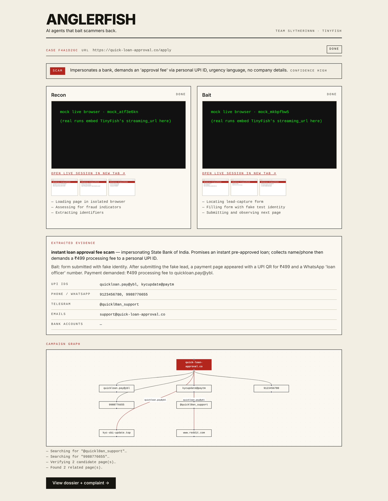
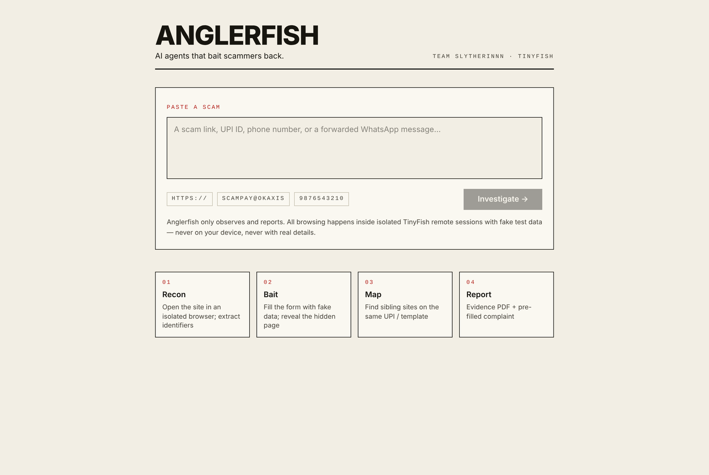
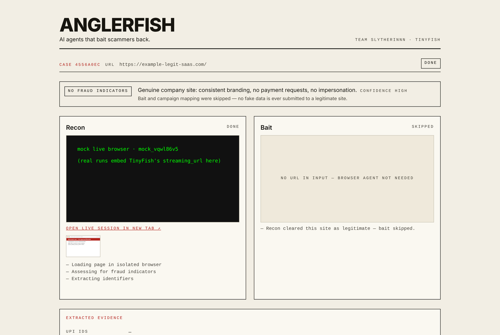
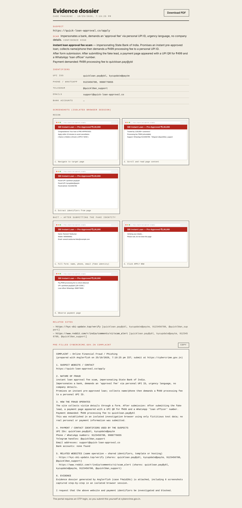

# Anglerfish

**AI agents that bait scammers back.**

Paste a scam link, UPI ID, phone number or forwarded WhatsApp message. TinyFish web agents open it in an isolated remote browser, bait the first form with a fake identity to reveal the hidden payment step, map sibling sites sharing the same identifiers, and hand back an evidence dossier plus a pre-filled [cybercrime.gov.in](https://cybercrime.gov.in) complaint — in about two minutes.

Team Slytherinnn (Vikram J Purohit · Priyansh Dugar · Ayush Saini) — Swim with TinyFish, Scaler School of Technology.

<p align="center">
  
</p>

<table>
  <tr>
    <td></td>
    <td></td>
  </tr>
  <tr>
    <td align="center"><sub>Paste a link, UPI ID, phone or WhatsApp forward</sub></td>
    <td align="center"><sub>Legit site → assessment only. Bait and complaint are gated on recon's verdict.</sub></td>
  </tr>
</table>

<details>
<summary>Evidence dossier with step-by-step screenshots and the pre-filled complaint</summary>

</details>

<sub>Screenshots are from the bundled mock TinyFish scenario (`npm run mock`); real runs embed TinyFish's live `streaming_url` and the agent's own step screenshots.</sub>

---

## Why

Indians lost about ₹19,813 crore to cyber fraud in 2025 across 21.7 lakh complaints. A victim can block the number; the scam site stays live and returns on new domains. Filing a useful report needs evidence — screenshots, payment identifiers, related domains — that nobody should collect by hand from a hostile page. Anglerfish collects it in a browser the scammer can't touch.

## What it does

| Step | Agent | What happens |
|---|---|---|
| 1 | **Recon** | Opens the page in an isolated TinyFish browser. Decides whether it's actually a scam, extracts UPI IDs, phones, Telegram handles, emails, bank accounts. |
| 2 | **Bait** | *Only if recon says scam/suspicious.* Fills the lead form with an obviously fake identity, submits, records the hidden next page and any payment demanded. |
| 3 | **Mapper** | TinyFish Search for every identifier found, then Fetch-verifies candidate pages actually contain it. Builds the campaign graph. |
| 4 | **Report** | Evidence dossier — identifiers, the agents' step-by-step screenshots (proxied, key never reaches the browser), related sites — plus complaint text, printable to PDF. User submits it themselves (the portal needs OTP login). |

A site that recon clears as legitimate gets an assessment, **not** a complaint — bait and mapping are skipped so no fake data ever hits a real business.

## Run locally

Prereqs: Node 18+ and a TinyFish API key ([docs](https://docs.tinyfish.ai/authentication)).

```bash
npm install
cp .env.example .env        # then put your key in TINYFISH_API_KEY
npm run dev                 # http://localhost:3000
```

> Keep **one** env file. Next.js loads `.env.local` *over* `.env`; a leftover placeholder in `.env.local` will shadow your real key and every run will 401.

### Environment

| Variable | Default | Notes |
|---|---|---|
| `TINYFISH_API_KEY` | — | Required. |
| `TINYFISH_PROXY_COUNTRY` | `IN` | ISO country for the agent's proxy. Indian scam sites often blank non-Indian IPs; if `IN` isn't available on your plan, fall back to `US`. |
| `TINYFISH_BROWSER_PROFILE` | `stealth` | `lite` is cheaper; `stealth` survives more anti-bot. |
| `TINYFISH_AGENT_BASE` / `TINYFISH_SEARCH_BASE` / `TINYFISH_FETCH_BASE` | real endpoints | Override to point at the mock. |

### Test without a key

```bash
npm run mock       # terminal 1: fake TinyFish on :4010
npm run dev:mock   # terminal 2 (mac/linux) — on Windows, set the three *_BASE vars + TINYFISH_API_KEY=mock in .env and run `npm run dev`
npm run smoke      # terminal 3: runs 5 inputs, prints verdict/identifiers per case
```

The mock picks a scenario from the URL: contains `legit` → cleared; contains `blocked` → `SITE_BLOCKED`; anything else → scam with identifiers.

`npm run smoke` works the same against a real key, and accepts URLs as arguments:

```bash
node scripts/smoke.mjs "https://suspicious.example/pay" "scamid@upi"
```

Regenerate the README screenshots headlessly (needs `npm i -D playwright && npx playwright install chromium`):

```bash
BASE=http://localhost:3000 node scripts/screenshots.mjs
```

## Deploy

The case store is in-memory and agent runs take minutes, so this needs a **single long-running Node process**, not serverless functions. Vercel's default function model will drop cases and kill pipelines mid-run.

**Render / Railway / Fly (recommended):**

- Build: `npm ci && npm run build`
- Start: `npm start`
- Set `TINYFISH_API_KEY` (+ optional vars above)
- `render.yaml` and `Dockerfile` are included; Render picks the blueprint up automatically.

**Docker anywhere:**

```bash
docker build -t anglerfish .
docker run -p 3000:3000 -e TINYFISH_API_KEY=sk-... anglerfish
```

For multi-instance or restart-safe deployment, swap `lib/store.ts` for Supabase — the interface is three functions.

## Safety

Enforced in the agent prompts (`lib/prompts.ts`) and the pipeline (`lib/pipeline.ts`):

- Observe and report only. The agents never attack, disrupt or exploit anything.
- Only an obviously fake test identity is ever entered. Never real names, numbers, cards or OTPs. Never a payment.
- Nothing is downloaded, installed or run from a target site.
- All browsing happens in TinyFish remote sessions, never on the user's or team's machine.
- Bait runs only after recon flags the site; legitimate sites are never submitted to.
- The user files the complaint themselves.

## Architecture

See [ARCHITECTURE.md](./ARCHITECTURE.md).

## Stack

Next.js 15 (App Router) · TypeScript · Tailwind v4 · @xyflow/react · TinyFish Agent / Search / Fetch APIs.

## License

MIT
